<picture>
  <source media="(prefers-color-scheme: dark)" srcset="./assets/singularity-hero-dark.svg">
  
</picture>

<b>Sushil Kumar</b> · Full-Stack Developer

<a href="https://www.devsushil.in/">www.devsushil.in</a> &nbsp;·&nbsp; <a href="mailto:sushilbyte7@mail.com">sushilbyte7@mail.com</a> &nbsp;·&nbsp; <a href="https://www.linkedin.com/in/sushilbyte7/">LinkedIn</a>

> **Mission brief.** the more you try the more you will realize how deep the ocean is.......
>
> **Current objective.** Building cool side projects

#### Telemetry

<picture>
  <source media="(prefers-color-scheme: dark)" srcset="./assets/singularity-telemetry-dark.svg">
  
</picture>

Reading the instruments

- **Accretion disk:** one particle per day of the last year; brighter and closer to the hole means a busier day. Inner rings orbit faster, as they would around a real black hole.
- **Orbit:** contributions per month, plotted as a closed trajectory; the beacon marks the busiest month.
- **Spectral composition:** language share by bytes across public repositories.
- **Light theme:** rendered as a photographic negative, the way astronomical survey plates were printed.

Artwork: original animated SVG, generated by README Templates · template: Singularity. Motion stops if your system asks for reduced motion.

#### Flight log

- `MSN-01` **[college-wifi-auto-login](https://github.com/sushilbyte7/college-wifi-auto-login)** · Smart event-driven WiFi auto-login system for college networks  
  Python
- `MSN-02` **[reels-subtitle-generator](https://github.com/sushilbyte7/reels-subtitle-generator)** · AI-powered one-word subtitle generator for viral Reels & Shorts. Runs 100% locally.  
  Python
- `MSN-03` **[dome-gallery2](https://github.com/sushilbyte7/dome-gallery2)**  
  TypeScript
- `MSN-04` **[portfolio-v2](https://github.com/sushilbyte7/portfolio-v2)**  
  TypeScript

<picture>
  <source media="(prefers-color-scheme: dark)" srcset="./assets/singularity-end-dark.svg">
  
</picture>

